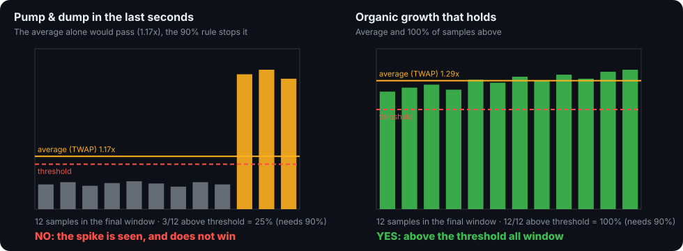
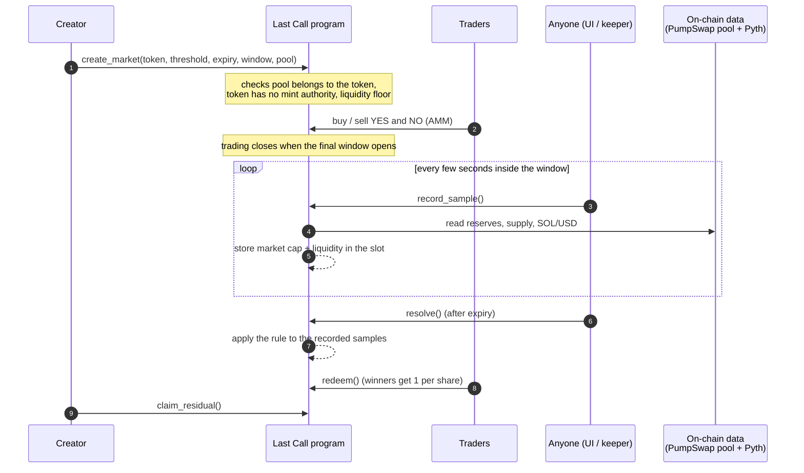
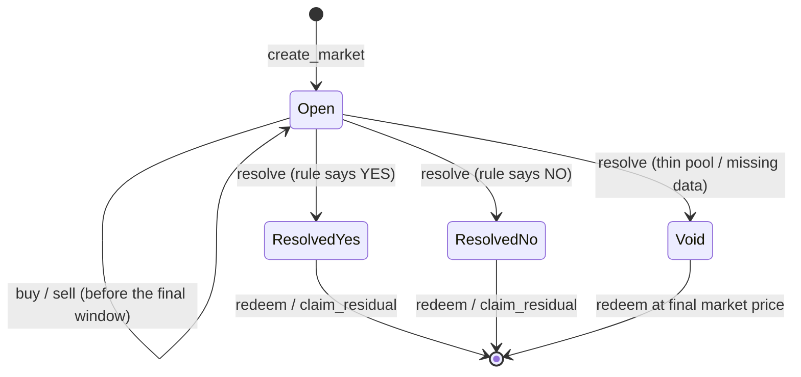
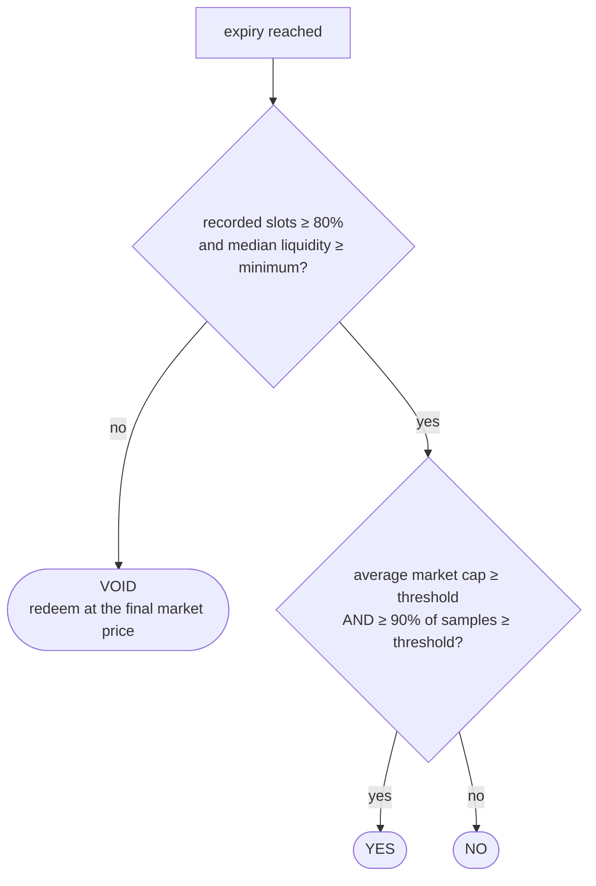
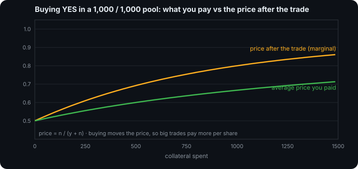
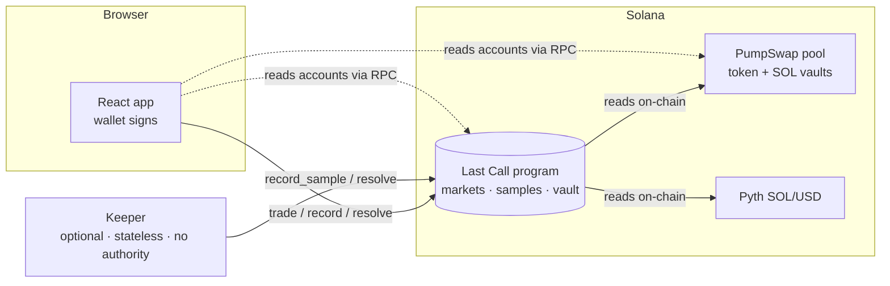

<p align="center"></p>

<h1 align="center">Last Call</h1>
<p align="center"><b>Prediction markets on newly launched tokens, resolved by the smart contract itself.</b><br>
<i>"Will this new token still be standing when the bell rings?"</i></p>

<p align="center">Solana · Anchor · TypeScript · React · <a href="https://last-call.fun">last-call.fun</a></p>

> **Status: hackathon build, devnet only.** The contract is deployed on Solana devnet and has had an internal security review, but it is **unaudited**. Nothing is deployed on mainnet and no real funds are involved.

---

## What it is

New tokens are thin and easy to pump for a few seconds. A prediction market that resolves on "the price at the deadline" is therefore trivial to manipulate.
**Last Call** lets you bet **YES / NO** on questions like *"Will token T have a market cap ≥ $1,000,000 at expiry?"*, but the outcome is decided on **how the token holds up through
a final window**, not on a single instant, and the decision is taken **on-chain, by the contract**, from prices it reads itself. There is no resolver, no oracle service of ours and no backend API.

<p align="center"></p>

## Features

| | |
|---|---|
| **Sustained-price resolution** | The outcome uses the average (TWAP) *and* requires ≥ 90% of the final-window samples above the threshold; a spike cannot win |
| **On-chain, permissionless** | Anyone records prices (`record_sample`) and anyone resolves (`resolve`): no key can decide an outcome, nobody can stop a resolution |
| **Real data, read on-chain** | Token price from the **PumpSwap** pool (vault balances + mint supply) and **Pyth SOL/USD**, verified account by account |
| **Safe by default** | VOID instead of a wrong answer when data is thin or missing; liquidity floor ($5k); tokens whose issuer can print supply or drain the pool are refused |
| **Always-available trading** | Constant-product market maker: buy and sell YES/NO any time before the final window, with slippage protection |
| **Solvent by construction** | The vault always covers every payout (property-tested on random sequences); rounding always favours the pool |
| **Verifiable** | Samples and the result live in the market account; the UI shows "if it resolved now" using the same rule as the contract |
| **Minimal backend** | Only an optional, stateless keeper that sends the permissionless transactions. No database, no open port, no privileged key |
| **Careful UI** | Wallet signs everything, exact amounts in every confirmation, network guard, strict CSP, no keys in the app |

## How a market works



### Market states



## The resolution rule

The final window is split into equal time slots (for example 5 minutes → 30 slots of 10 s). One sample per slot; the first valid writer wins.



* **Why both conditions:** in the chart above the pump makes the average pass (1.17×) but only 25% of samples are above the threshold, so the market resolves **NO**.
* **Why VOID exists:** missing or thin data must never produce a confident wrong answer.
* **Where it lives:** `programs/lifecycle_markets/src/rules.rs` (pure function, unit-tested at every boundary) and mirrored in the SDK (`evaluateWindow`).

## Pricing: the market maker

Two reserves `y` (YES) and `n` (NO), fixed product. `price_yes = n / (y + n)`. Every trade moves the price, and rounding always favours the pool.

<p align="center"></p>

```
buy a of side YES : fee = ceil(a·bps/1e4);  net = a − fee
                    shares = (y + net) − ceil(y·n / (n + net))
sell s shares      : r = ((y+s+n) − √((y+s+n)² − 4·s·n)) / 2   (floor)
```

Worked example (no fee): `y = n = 1000`, buy 100 YES → 190.9 shares, price YES 50% → 54.7%.
Settlement: a winning share pays 1 collateral unit; **Void** pays the final marginal price per share.
**Solvency:** `vault = total_minted + fees` before payouts, and the winners' claims never exceed it.

## Architecture



| Part | Where | What it does |
|---|---|---|
| **Program** | `programs/lifecycle_markets` | AMM, sampling, resolution rule, price readers (`math.rs`, `rules.rs`, `sources.rs`) |
| **SDK** | `sdk/` | Typed client from the IDL; BigInt mirrors of the on-chain maths (golden-tested against Rust on real mainnet data) |
| **Web app** | `web/` | Markets, live market cap and chart, trading, positions, create market, resolution panel |
| **Keeper** | `keeper/` | Optional bot that sends `record_sample` / `resolve`; holds no authority, exposes no port |
| **Scripts** | `scripts/` | build (test/prod), deploy, keys, create market, scenarios, local stack |

## Trust model: what is and is not trusted

| Trusted | Not trusted / not needed |
|---|---|
| **The program** (unaudited, upgradeable until the authority is moved to a multisig and revoked) | A resolver, an oracle operator, a backend, the keeper, the website |
| **Pyth SOL/USD** (fresh ≤ 5 min, confidence ≤ 2%) | The caller of `record_sample` / `resolve`: they supply no number |
| **One pool's spot state** (see below) | The token issuer (mint authority and dangerous Token-2022 extensions are rejected) |

**Known limit:** a spot price can be pushed by someone with capital. Defences raise the cost (90% sustained + TWAP, liquidity floor, one standalone transaction per sample,
trading closed during the window) but cannot remove it with spot data. Keep each market small relative to the pool's depth. See the security review below.

## Quality

| | |
|---|---|
| Contract | **70 Rust tests**: maths, the rule at every boundary, full lifecycle, 75 randomized solvency sequences, real mainnet PumpSwap/Pyth snapshots, 12 security tests (exploit → fix) |
| SDK | TypeScript maths reproduce the program's numbers exactly on real data (golden vectors) |
| Static checks | `clippy` clean, `cargo audit` 0 vulnerabilities, production build proven free of the test feed |
| Review | Line-by-line security review with exploit-first tests (summary below) |

## Quick start (local)

```bash
# toolchain: Rust, Solana CLI (Agave 4.x), Anchor 1.2.1 (avm), Node ≥ 20
npm install
bash scripts/build.sh test            # program with the TEST price feed (tests + local stack)
cargo test -p lifecycle_markets       # 70 tests
npm run build -w sdk && npm test -w sdk -- test/math.test.ts test/sources.test.ts
bash scripts/dev-local.sh             # local validator + keeper + faucet + seeded markets
npm run web                           # http://localhost:5173 (a dev-only wallet is auto-created)
```

## Program interface

| Instruction | Who | What it does |
|---|---|---|
| `create_market` | anyone | Creates a market, its vault, sample buffer and seed liquidity. Verifies the PumpSwap pool belongs to the token, the mint has no mint authority, and the liquidity floor |
| `buy` / `sell` | traders | Trade YES/NO against the AMM, with slippage limits; closed once the final window opens |
| `record_sample` | anyone | Reads pool vaults, mint supply and Pyth SOL/USD, stores market cap and liquidity in the current slot (first writer wins; must be a standalone transaction) |
| `resolve` | anyone, after expiry | Applies the rule to the recorded samples: YES, NO or VOID |
| `redeem` | position holders | Pays winners 1 collateral unit per share (VOID: the final marginal price) |
| `claim_residual` | creator | Withdraws what is left after all obligations (computed from state, not from the vault balance) |
| `demo_set_feed` | test builds only | Fake price feed for local demos; compiled out of production builds (`demo-feed` feature) and returns `DemoDisabled` otherwise |

Accounts (PDAs): `market ["market", creator, id]`, `vault ["vault", market]`, `position ["position", market, user]`, `samples ["samples", market]`, `feed ["feed", token_ref]` (test only).

Data sources: PumpSwap program `pAMMBay6oceH9fJKBRHGP5D4bD4sWpmSwMn52FMfXEA` (pool, base/quote vaults, token mint; WSOL quote only) and the Pyth SOL/USD receiver account (age ≤ 300 s, confidence ≤ 2%, full verification).
`market cap = supply × SOL-per-token × USD-per-SOL`; `liquidity = 2 × SOL in pool × USD-per-SOL`.

## Security review

An exploit-first review was run on the program (every instruction, account check and arithmetic path). Each finding got a failing test first, then the fix.

| Area | Result |
|---|---|
| Account validation | Pool, vaults, mints and Pyth account are verified by owner, discriminator and cross-references; nothing is taken from the caller as a number |
| Manipulation | Standalone-transaction check for `record_sample`, slot-based single sample, trading closed during the final window, liquidity floor ($5k), TWAP plus 90% sustained rule |
| Token safety | Mint authority must be absent; Token-2022 `PermanentDelegate`, `TransferHook` and `Pausable` rejected; collateral must have no freeze authority (USDC excepted) |
| Arithmetic | `overflow-checks` on, reserves capped at 2^62, rounding always favours the pool, solvency property-tested |
| Test-only code | The demo feed is behind a cargo feature; a test proves the production binary rejects it |
| Tooling | `clippy` 0 warnings, `cargo audit` 0 vulnerabilities |

Findings fixed during the review: trading was possible during the sampling window (now closed), markets could be created with an expiry shorter than the window, thin pools could be used (liquidity floor added), unsafe tokens and collateral with freeze authority were accepted (now rejected), and `record_sample` could be bundled with manipulating instructions (now standalone-only).

Responsible disclosure: `security.txt` is embedded in the program and served at `/.well-known/security.txt`.

## Devnet deployment

| | |
|---|---|
| Program | `2oLfv3LDx7bDCzbnkzuvmT13s6xrxWawJr97NcGmKwLJ` (test build, includes the demo feed) |
| Collateral | a test token minted by `scripts/create-collateral.ts` (address in `deployments/devnet.json`) |
| Seeded markets | 4, listed in `deployments/devnet.json` |

Runbook (secrets live in `.env`, never committed; copy `.env.example`):

```bash
npm run keys                     # generate local keypairs (gitignored)
npm run deploy:devnet            # build + deploy the test build to devnet
npm run create-collateral        # test collateral mint (idempotent)
npm run seed                     # seed markets
npm run scenario                 # run a scenario (organic_growth, pump_and_dump_attack, thin_liquidity, stays_below)
npm run keeper                   # NETWORK=devnet, sends record_sample / resolve
npm run faucet-server            # optional faucet for test collateral
npm run web                      # UI; choose the network in the header
```

RPC: any provider works for normal reads and transactions (`VITE_*_RPC_URL`, `RPC_URL`). `getProgramAccounts` is often disabled on free tiers, so listing markets uses a separate endpoint (`VITE_LIST_RPC_URL` / `LIST_RPC_URL`, default the public Solana RPC), with a fallback to the known market list.

## Mainnet

Not deployed, and deployment scripts refuse it. Before any real-funds use: independent audit, production build (`bash scripts/build.sh prod`, no demo feed), reproducible build verification, upgrade authority moved to a multisig and then revoked, and a deliberate manual deployment.

## Repository layout

```
programs/lifecycle_markets/   Anchor program + tests (LiteSVM, real mainnet fixtures)
sdk/                          TypeScript client + maths mirrors
keeper/                       optional stateless bot
web/                          React app (Vite)
scripts/                      build, deploy, keys, create-market, scenarios
docs/assets/                  logo and chart images used by this README
```

## Roadmap

- Cumulative / TWAP pool oracle instead of spot state; more venues (Raydium, Meteora) and multi-pool markets
- External audit, `solana-verify` reproducible build, multisig upgrade authority
- Keeper as a serverless worker; indexer for market history and leaderboards
- Rent reclaim (close accounts), market duration limits (see open questions in the review)

## Disclaimer

Experimental software, unaudited. Devnet tokens have no value. Not financial advice. Do not use with real funds before an independent audit.
